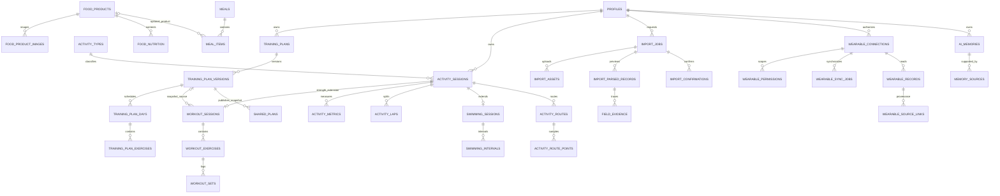

# FITNESS OS 2.0 — PHASE 0 技术实施报告（完整文档复审版）

日期：2026-11-03（Asia/Shanghai）。项目根：`/workspace/fitness-os-2.0`。本阶段仅文档整理、设计和可行性审核，未进入 PHASE 1。

## 1. 文档整理、完整阅读与覆盖率

已取得 `FITNESS-OS-2.0-PROJECT-DOCS.zip`（25,038 bytes），验证压缩包条目路径和无符号链接后，完整读取17份文件，包括隐藏的 `.env.example`。所有工作文档直接放入 `docs/`，不再嵌套 `FITNESS-OS-2.0-PROJECT`。未改动旧项目 `/workspace/gpt`。

复制前逐个比较同名目标：新项目目标均不存在，无覆盖冲突。17份原始文件按 ZIP 层级逐字节保存在 `documentation-originals/FITNESS-OS-2.0-PROJECT/`，由 `DOCUMENT_MANIFEST.json` 记录原始和工作副本 SHA-256。工作副本仅 `docs/README.md` 与 `docs/MASTER_PROMPT.txt` 修正导航引用并添加路径说明，其余15份字节不变；原始需求及阶段文字不删改。

`docs/INDEX.md` 是新的完整索引。逐文件审阅结论、逐条来源行号与设计映射见 `REQUIREMENTS_COVERAGE.md`。

| 覆盖口径 | 本次结果 | 含义 |
| --- | --- | --- |
| 原始文件阅读与保留 | 17/17，100% | 原始副本逐字节保留，含配置示例 |
| PRD 的项目符号条目 | 98/98 已映射 | 设计/路线覆盖；不等于严格统计全部自然语言中的原子需求 |
| FEATURES 勾选功能 | 64/64 已映射 | 原勾选状态保持未完成；包含OpenAI和Gemini两种指定适配器 |
| TEST_CASES 验收条目 | 43/43 已映射 | 尚未执行业务测试，不能称43项通过 |
| 数据库基线、编号流程和章节正文 | 已逐节审核 | 关系和缺口在下文单列，不只依靠勾选清单 |
| 应用实现/设备能力验证 | 未开发/未验证 | 本次不创建业务实现 |

### 与上一版报告相比的重要修正

- 文档缺失已解决；原数据库命名以 `DATABASE.md` 的 `user_id` 为准，上一版 `owner_id` 是建议别名，不在同一项目混用。
- 管理员管理公共素材、模型配置、系统用量和审计，默认不得任意读取私人健康数据；不以 admin 角色绕过全部 RLS。
- 完整保留社区搜索、公开计划收藏/复制、用户通知、身体数据、合法动作媒体、RIR/RPE、PR/肌群量/渐进超负荷、中文简写和AI计划确认。
- 补足游泳出发间隔/休息/游进时间、全部运动专属指标、GPS漂移与来源、液体 ml/g 密度限制、每份/整包营养及食物估重。
- 补足指定 OpenAI/Gemini、AI成本面板、记忆导出、人体肌群3D、粒子效果、缓存生成模型和移动降级。
- 历史年龄/体重/力量/游泳及疼痛资料不得变成当前事实；需用户确认日期、现状与计划版本后才能导入，当前未seed。
- `PHASES.md` 为0–10细分路线，MASTER原文为0–9；下一步工作方案暂按更细的 PHASES 展开，保留映射而非删除任一范围。

## 2. 环境检查、产品与架构决策

当前可访问的是 Debian 13 x86_64 云环境，不是用户的 Windows 电脑。前次实测：Node 24.19.0、npm 11.9.0、pnpm 11.25.0、Git 2.52.0、Python 3.12.14；约33 GiB内存与60 GiB可用磁盘。Docker/Java命令存在，未验证daemon或原生构建。未发现Xcode/Swift/adb/psql。环境版本证据来自此前 PHASE 0 检查，并非用户电脑检查结果。

前次官方 npm registry 返回 Next 16.4.4（Node≥20.9）、Supabase JS 2.118.0（Node≥22）、React 19.3.1、Tailwind 4.3.4；这些只是当时 registry 元数据，不是已安装或锁定的组合。PHASE 1 再验证兼容并精确锁定，不能将 engine 满足解释为构建测试通过。

本机待检：Windows版本、Node/包管理器/Git版本、内存/磁盘、工作目录；若本机只作浏览器客户端可不安装整个工具链。Windows + Node/Git可做Web开发，WSL2/Docker仅在本地Supabase等需要时加入。iOS真机桥接另需Mac/Xcode及签名环境，不能由Linux云机替代。

### 架构选择

遵循 `ARCHITECTURE.md`，初期采用 Next.js/React/TypeScript 模块化单体、Tailwind + shadcn/ui、Motion、Supabase PostgreSQL/Auth/私有Storage、Zod、Vitest/Playwright、PWA/IndexedDB。按需引入Three.js/React Three Fiber。相较此前建议的多包monorepo，先用文档推荐的 `src/features` 结构减少运维与构建成本，未来再抽共享包及原生伴侣，不改变领域边界。

```text
fitness-os-2.0/
  docs/                         # 17份工作文档 + 新索引
  documentation-originals/      # 不可变原始档案
  src/app/                      # 后续阶段创建，路由/BFF
  src/features/                 # dashboard/auth/training/sports/swimming/
                                # nutrition/import-center/wearable/ai-coach/
                                # memory/community/admin
  src/lib/                      # ai/database/calculations/validation/storage/sync/geo
  src/types/
  supabase/migrations/
  public/                       # 仅公开静态素材；不放私人上传或备份
  tests/
```

上面 `src/` 等为未来结构，当前并未创建业务工程。AuthService、TrainingService、SportsService、SwimmingService、NutritionService、ImportService、WearableService、MemoryService、AIService、MediaService、SyncService 为模块服务边界，不要求分别部署为微服务。

Web/PWA负责手动记录、计划、营养、导入、前台GPS及同步；原生伴侣负责平台健康API及需要可靠后台能力的任务。AI/OCR/大文档解析走作业接口，数据库任务表可作为低成本队列，达到需要时加入独立worker，不在短时HTTP请求中等待所有步骤。作业采用原子领取、租约、退避、最大重试和死信状态。

## 3. 多用户、跨设备和数据生命周期

- PostgreSQL是已确认数据的权威源，IndexedDB缓存必要用户数据与离线outbox；登出清缓存，避免共享设备泄露。私人页面、API响应和签名文件链接不进入公共PWA/CDN缓存。
- 写入包含UUID、idempotency_key、base_version。数据库乐观锁检查冲突；已确认计划不能静默最后写入覆盖。合并或选择冲突版本必须可追踪。
- Realtime仅作通知，断线重连按游标补拉；不能仅依赖在线WebSocket保持一致。删除带tombstone及清理周期。
- UTC `timestamptz` + 原始时区/IANA timezone/必要原偏移 + 业务local_date，避免午夜和夏令时归组错误。原始单位和值与规范值并存。
- 同一来源重复同步幂等；跨平台镜像可能有不同source ID，保留provenance并候选匹配，不把所有设备值直接累计。
- 所有私人导出、备份、原文件、派生记忆/向量有保留和删除策略；撤权立即停调度，断开不等同于删除。用户需可单独删除导入记录。

## 4. 各运动类型的数据模型

共享 `activity_sessions`：id UUID、user_id UUID、type_id、start_at/end_at timestamptz、timezone text、local_date date、elapsed_s/moving_s/paused_s、distance_m nullable、active_energy_kcal nullable、平均/最大心率 nullable、RPE nullable、notes、capture_mode、source_id、device引用、estimated flag、created_at/imported_at、version。缺失值用NULL，不用0冒充真实数据。会话是否进行中决定end_at是否必填；结束后检查时间顺序。

`activity_types` 注册类型、必填字段、允许指标、单位、表单/校验Schema版本。`activity_metrics`保存受控指标代码/数值或专属结构、单位、来源、measured/manual/derived/estimated；不能用无约束JSON替代关系模型。每次写入验证运动类型与指标一致性，默认单位仅用于展示，不替代来源记录。

| 类型代码 | 专属字段/关系 | 校验与计算 |
| --- | --- | --- |
| strength（力量） | workout_sessions/exercises/sets；重量、组数、次数、RIR/RPE、休息、肌群 | 训练快照与计划版本关联；自重/辅助/单侧计量明确；PR公式/训练量算法版本化 |
| swimming | swimming_sessions、intervals、drills、records、styles；池长、泳姿、组/趟、出发间隔、休息 | swim_time、rest_time、sendoff_interval分开，不能把出发间隔当实际游进；池长25/50米或自定义 |
| outdoor_run | distance、laps、pace、cadence、HR、route、elevation | 配速s/km；时长/距离可计算，零距离不除零；路线/爬升有质量门槛 |
| treadmill | duration、speed、incline_percent、distance、HR | 普通跑步机可坡度0；坡度百分比与角度不可混用；能量估算注明 |
| indoor_cycle | duration、device_distance/speed、resistance、power_W、cadence_rpm、HR | 无设备值为NULL；不能用虚拟距离冒充GPS距离；阻力标明设备刻度 |
| hike | duration、distance、route、altitude、ascent、HR | GPS/手动来源区分；海拔质量不足不自动生成可信爬升 |
| elliptical | duration、resistance、steps/cadence、device_distance、HR | 不默认机器阻力跨型号可比；缺失指标不可推算成实测 |
| rowing_machine | duration、distance、pace_s_per_500m、stroke_rate、power_W、HR | 配速单位500m与跑步的km分开；记录设备来源 |
| jump_rope | duration、jump_count、sets、intervals、HR | 有效跳数与估算次数区分；组间休息单列 |
| stair_climber | duration、level/speed、floors/steps、HR | 楼层换算高度需设备依据；等级不是统一SI速度 |
| other | custom_name、category、duration、可选distance/intensity/notes、自定义指标 | 自定义指标绑定可校验定义和单位，不允许任意无效字段 |

分段统一 `activity_laps`，游泳专属分组保留独立表；GPS `activity_routes` → `activity_route_points`，点包含时间、lat/lon、accuracy、可选altitude/speed/heading、来源与过滤结果。保留采样缺口，不用插值点冒充实测；暂停段不累计训练路线距离，清理操作可追溯。路线默认私人，公开需主动选择并支持隐私模糊。

力量计划必须支持手动创建/编辑/复制/删除及日/周/周期安排。`training_plan_versions`确认后不可变；训练执行使用版本和动作/组次快照。删除计划不级联删除已执行训练。历史PR和肌群量按算法版本重算，合法动作媒体保留license/source。

## 5. 数据库实体关系与RLS

### 基线实体逐组保留

| 领域 | 文档中的实体及关系设计 |
| --- | --- |
| 用户 | auth.users 1:1 profiles；1:N user_preferences/user_settings（可设计为每用户单行并unique） |
| 身体 | 用户1:N body_metrics/body_measurements/body_composition；测量日期/来源/单位/历史待确认 |
| 力量 | exercises 1:N exercise_media；training_plans 1:N training_plan_versions → training_plan_days → training_plan_exercises；workout_sessions → workout_exercises → workout_sets；personal_records引用实际记录 |
| 通用运动 | activity_types 1:N activity_sessions；session 1:N activity_metrics/activity_laps/activity_notes；activity_sources记录来源；session 1:N activity_routes → activity_route_points |
| 游泳 | swimming_sessions 1:1 activity_sessions；swimming_intervals/swimming_drills/swimming_records引用会话；swimming_styles字典 |
| 食品 | foods通用食物；food_products商品；food_product_images/food_labels/food_ingredients/food_nutrition/food_barcodes为商品子表；meals → meal_items；nutrition_records为显式快照/汇总；user_food_favorites |
| 导入 | import_jobs → import_sources/import_assets/import_parsed_records/import_confirmations；正式记录反向引用job/parsed_record |
| 设备 | wearable_connections → wearable_permissions/wearable_devices/wearable_sync_jobs；wearable_records及wearable_source_links保留来源/标准记录关系 |
| AI | ai_conversations → ai_messages；ai_memories → ai_memory_summaries（来源关系需补表）；ai_model_configs、ai_usage_logs |
| 社区/系统 | shared_plans为发布快照；user_favorites、notifications、audit_logs；补充发布版本条目与搜索索引，不读取私人计划做公开搜索 |

最小补充：nutrition_plans/nutrition_plan_versions/nutrition_plan_items（或通用plan类型）；user_food_tags及关联；field_candidates/field_evidence（食品与导入字段证据）；memory_sources/memory_embeddings（仅需要时）；mutation_receipts/sync_changes；job预算预占/结算表；受限schema的connection_secrets。这些是待确认的设计补充，不是已经运行的数据库。身体三类表和 nutrition_records 的重复语义需在 PHASE 2 明确唯一事实源，避免多表同时写入同一事实。



所有私人表使用 `user_id UUID`，主键UUID；父表添加unique(id,user_id)，子表复合FK(parent_id,user_id)确保不能把自己的子行挂到别人父行。金额用整数最小单位/明确币种，营养用numeric、时间用timestamptz；经纬度检查范围；计数和距离非负、RPE/RIR范围显式、结束时间不早于开始。高频采样按需求分区或压缩原文件，不一开始无限堆JSON。

索引：每个私人表覆盖(user_id,业务时间)、外键；计划unique(plan_id,version_no)；设备unique(user_id,provider,record_type,source_record_id)与dedup_key；导入确认/幂等键unique；公开计划按发布状态/标题搜索。按EXPLAIN与实际查询优化，不盲目给所有JSONB建GIN。

### 权限矩阵

| 数据 | 匿名 | 本人 | 其他登录用户 | 产品管理员 | 特权worker |
| --- | --- | --- | --- | --- | --- |
| 私人身体/运动/营养/记忆/轨迹/上传 | 无 | 受业务规则CRUD | 无 | 默认无 | 仅授权任务最小范围 |
| 已发布计划快照 | 仅读公开字段 | 读；发布/撤回经服务端确认 | 仅读；收藏/复制入自己空间 | 公共内容审核 | 发布/审核任务 |
| 公共动作与合法媒体 | 经许可的只读 | 只读；自建动作用私人表 | 同左 | 公共内容管理 | 素材任务 |
| 个人收藏/通知 | 无 | 本人读写；系统字段只读 | 无 | 默认无 | 指定发送任务 |
| 模型公共配置 | 仅必要公开展示字段 | 同左 | 同左 | 受审计管理 | 限定读取 |
| 密钥/设备token/内部审计 | 无 | 无直接读；只返回安全状态 | 无 | 不默认看原始密钥 | 受限schema与用途 |

```sql
-- 设计示例，不是已执行迁移；所有私人表需分别审计。
alter table public.activity_sessions enable row level security;
create policy session_select on public.activity_sessions
  for select to authenticated using ((select auth.uid()) = user_id);
create policy session_insert on public.activity_sessions
  for insert to authenticated with check ((select auth.uid()) = user_id);
create policy session_update on public.activity_sessions
  for update to authenticated
  using ((select auth.uid()) = user_id)
  with check ((select auth.uid()) = user_id);
create policy session_delete on public.activity_sessions
  for delete to authenticated using ((select auth.uid()) = user_id);
```

此策略还需配合grants、复合外键、业务状态检查。已确认计划版本不可任意update；AI提案确认用事务/RPC及版本检查。公开行不可通过修改user_id、role或visibility绕过发布流程。

Storage使用私有bucket，storage.objects策略检查bucket与用户目录；下载发短时签名URL并验证归属。令牌放受限schema/安全密钥存储，不在客户端可查询表；`service_role`不返回前端。普通服务端请求使用用户会话验证身份与RLS，后台管理员凭证不能替代业务授权。SECURITY DEFINER固定search_path并收紧execute；审查视图安全和Realtime订阅。

必须在P2执行匿名/A/B/管理员/worker测试，覆盖REST/RPC/Storage/Realtime、跨用户外键、猜ID、owner变更、公开快照、批量导出和记忆检索。当前均为待执行设计，未宣称RLS已安全运行。

## 6. 食品多图导入模型

`import_jobs(kind=food_product)`聚合一件商品；`import_assets`存每张图片及角色(front/back/ingredients/nutrition/barcode/other)、hash、私有对象路径、排序、MIME/大小。`import_parsed_records`存候选商品，字段证据指向asset、页码/图像区域、原文、置信度、解析版本、明确/推导/缺失/不确定标志与用户修正。置信度无法量化时用待确认状态，不伪造精确概率。

确认后创建/更新 `food_products`（brand、name、variant、net_amount/unit）、`food_product_images`、`food_labels`、`food_ingredients`、`food_nutrition`、`food_barcodes`，记录import确认和版本。食品默认私人；条码不是全球配方的唯一真相，同品牌不同规格和地区仍可独立档案。图片疑似不同商品时提示拆分。

营养字段包含nutrient_code、amount、unit、basis_amount/unit（100g/100ml/每份/整包）、serving_size、来源及确认状态。能量1 kcal=4.184 kJ；钠/盐、mg/g、糖与总碳水区分；标签未提供的营养素为unknown而不是0。液体ml转g必须有密度依据，否则只保留原计量或明确估算。照片估重也必须标为estimated并由用户确认。

`meal_items`保存用量与当时营养快照，不因食品库后来改标签而改历史。早餐/午餐/晚餐/加餐、日/周/月统计、目标完成度、最近/收藏/自定义标签/一键复用完整保留。计算由程序执行；视觉/OCR只辅助提取，不决定未授权的正式写入。

## 7. 智能导入、AI多模型与长期记忆

流程：接收原文/文件 → 类型/语言检测与安全限制 → 本地文本提取或按需OCR/视觉 → 规则/AI分块解析 → 结构化中间格式 → 单位/日期/动作/运动类型/组次校验 → 合并跨块并标来源 → 可编辑预览/歧义提示 → 用户确认 → 基于版本和幂等键事务写入 → 保留原文、确认者、解析版本及审计。

作业状态：uploaded/parsing/needs_review/confirmed/committed/failed/cancelled。确认后不得替换预览内容再静默提交，应核对preview_version/hash；失败保留原文和错误，支持重新解析但不重复正式记录。跨类型大导入需明确全量事务或分批确认边界，不能部分成功却报全部完成。

格式：长文本（单日/整周/多周期）、饮食计划、运动记录；图片/截图；TXT/MD；文本PDF本地抽取、扫描PDF按需OCR；DOCX提取文本和表格。MIME/魔数、大小/页数/像素/解压体积限制、损坏/加密文件错误；不执行宏或文件中的指令。文件文本作为不可信数据，不能驱动工具执行或获取更多用户数据。CSV/JSON后续按schema支持导入/导出。

AI明确实现 OpenAI Adapter、Gemini Adapter 的统一接口（generateText、generateStructuredOutput、analyzeImage、parseDocument、usageMetadata），按任务路由而非默认同时调用。缺少某能力时返回unsupported，不假装每个供应商都能原生解析DOCX或生成3D。输出Zod/schema校验；文本、图像、长任务超时/重试和用量统一。

长期记忆包括偏好、食品标签、习惯、摘要、计划版本和纠正；记录来源、时间、有效期、确认状态、敏感级别。用户可查看/修改/删除/导出；派生摘要和向量同步失效。检索必须限定当前用户，embedding不能成为跨用户搜索旁路。

无key时仍可手动创建/编辑计划、手动记录、程序计算和人工结构化导入。AI方案仅提案，修改确认计划必须用户确认。速率/日/月/平台总预算、任务前预占及结算、重试幂等；成本面板显示真实usage与估计差异，收费AI/OCR/3D按DESIGN执行二次确认。

## 8. Apple与华为设备可行性

完整研究在 `WEARABLE_RESEARCH.md`，逐项矩阵在 `WEARABLE_CAPABILITY_MATRIX.csv`。

Apple：原生iPhone HealthKit桥接是路线，Web/PWA不能直接调用；后台同步不保证实时。要在Watch独立开始训练/实时交互须另评watchOS app，不算当前PWA已支持。具体授权、历史范围、可读写类型、路线和游泳指标待官方和真机核验。

华为：文档未给出明确编号的五条方式，因此暂分H1 Android Health Kit、H2 iOS Health Kit候选、H3官方云/Web候选、H4 Android Health Connect、H5 HarmonyOS原生候选。后两条不是HMS同义词；H2/H3的SDK/API存在性本身也待确认。这五条分别设计适配器，不能将它们显示为已连接；独立保留FileImport与Manual回退。

每种数据类型记录可读/可写、实时/历史、采样粒度、地区、permission scope、审核状态、合成内部字段例、单位、时区、证据等级。A1+H1–H5各15类共90条，具体能力一律待验证。未有官方scope的地方不编造字符串，合成样例不是SDK样本。

需核实：具体手表/手机/OS/账号地区/发布地区、个人或企业资格、SDK版本、签名、权限申请、审核与商用条款；测试部分授权、无数据、历史、去重、撤销和删除。Health Connect只读取实际写入且获授权的数据，不能假设华为所有数据都经过它。HarmonyOS按系统代际单独评估。

再次请求官方页面仍403（网络策略拒绝，不是服务本身不可用）。当前没有官方正文研究或真机验证证据，不能说已完成具体厂商可用性确认。没有购买/注册/抓取/绕权或索要用户账号密码。

## 9. 成本、账号API与备份恢复

### 预算情景（估算，不是当前报价）

本次Supabase/Vercel官网也被403拒绝。历史常见套餐价格仅供规划；当前价格、免费配额、商用限制、税/汇率、地区和成员计费需购买前核实。不重复假定免费服务具备生产备份或SLA。

| 阶段/项目 | 初期方案 | 后续费用风险 |
| --- | --- | --- |
| 开发Web/PWA/数据库 | 免费开发层或本地；无AI也可用 | 小量验证约US$0–10/月，取决于免费额度可用性 |
| 数据库/Auth/Storage | Supabase开发项目 | 历史常见Pro约US$25/月起；compute、存储、出站、项目数、Realtime、PITR另查 |
| Web部署 | 本地/兼容平台免费层 | 历史常见Vercel Pro约US$20/成员/月起；商用资格、函数时长/CPU、带宽超额另查 |
| AI/OCR | 单任务显式触发、压缩缓存、本地提取优先 | 轻量预留US$0–10/月，图片/长文密集远高于此；没有保证赠送额度 |
| 邮件/备份/监控 | 开发限额；独立加密备份 | 预留US$0–30+/月，邮件投递/出站/恢复工具成本待算 |
| 域名 | 初期不买 | 常见US$10–30/年；续费与地区不同 |
| Apple原生 | 初期不买开发者服务 | 历史常见分发计划US$99/年，资格/豁免/地区待核实；Mac/iPhone/Watch硬件另计 |
| Huawei/Android/HarmonyOS | 先资格与SDK研究 | 资格/申请/分发/服务收费未知，不报价为0；真机与原生开发另估 |
| 3D/地图/媒体 | 本地合法素材、按需加载 | 生成费用、模型存储、地图瓦片和版权授权另查；3D生成默认关闭 |

小规模正式在线服务可先预留US$50–100/月起，不含人工、硬件、域名、税及当前云环境平台费用；不是固定上限。模型/图片密集场景可能超过US$100/月。每月账单=固定套餐+compute/存储/出站+AI token/图片/embedding+OCR页数+邮件/地图/备份。应用额度不保证供应商发票硬封顶，需要配合服务商告警/停用及基础设施监控。

免费方案核对：暂停、数据库/文件容量、出站、项目数、连接数、认证邮件、函数时长、最大上传、日志、备份/PITR和商用条款。多图、GPS/传感器高频和多设备Realtime是主要变量。初期不买独立向量库/GPU/设备聚合API，不因省钱删RLS或备份。

### 需注册或配置的账号/API

- P1：复用GitHub；先在独立目录创建工程，不需要索要新token。无需AI和设备账号即可做本地基础工作。
- P2：Supabase项目、地区、Auth回调、公开URL和publishable/anon key；迁移/后台凭证仅服务端。生产邮件随后配置SMTP、域名/DNS与SPF/DKIM/DMARC。
- P5/P7：OpenAI/Gemini账号按需启用，文本/视觉模型、API key、预算；OCR可独立替换，不要求同时付费启用全部供应商。
- P8后：Apple开发者/签名/HealthKit、华为开发者与实际获批能力、Android/HarmonyOS原生工具链；不假设一个通用华为API key能读取所有数据。
- P10：部署账号、HTTPS、备份位置、监控与回滚。开发/测试/生产隔离。

保留 `docs/.env.example` 原模板，不填真实值、不生成含密钥配置、不要求聊天发送密钥。当前云平台若保留OPENAI_等变量名，应使用平台允许的机密绑定和服务端映射；原始模板不因环境限制删改。

### 导出、备份与恢复

P2先交付用户JSON/CSV导出（含单位、时间/时区、来源、运动类型/数据类型）；P3–P9扩展schema，P10全量恢复演练。原始媒体另附受控导出清单/文件，不能把只有数据库行称为完整备份。

建议生产初始目标：每日数据库和对象文件独立加密备份、保留周期可配置，RPO≤24小时、RTO≤1个工作日作为待演练目标，不是已达成SLA。先恢复到隔离环境，校验迁移版本、行数/FK、文件hash及随机业务记录；验证权限、计划历史、记忆和设备来源。备份不放public目录，权限最小化，不把真实设备token导出给普通用户；恢复后令牌有效性另验。支持用户删除、撤权、关联文件和记忆清理，备份过期删除有明确说明。

## 10. 完整路线与PHASE 1具体方案

阶段依据：按 `PHASES.md` 细分执行建议，MASTER保持原文。旧报告与新路线对应如下：

| 新阶段 | 交付范围 | 与MASTER/旧报告对应及验收 |
| --- | --- | --- |
| 0 | 本报告、17文档覆盖、模型/RLS/平台研究 | 仍待用户确认；部分官方/真机可行性未闭合 |
| 1 | 基础工程、设计系统、响应式、Dashboard、PWA骨架 | MASTER P1；生产构建、交互和PWA检查 |
| 2 | Auth、迁移、RLS、资料、同步、导出 | MASTER P2；匿名/A/B隔离、跨设备/离线/冲突 |
| 3 | 自主力量计划/版本、训练、游泳、全部手动运动 | MASTER P3；数据持久化、专属指标、无AI完整手动流程 |
| 4 | 前台GPS/隐私/漂移/暂停 | MASTER P7中的GPS提前独立；不承诺后台 |
| 5 | 营养/多图食品/标签/食物记忆 | MASTER P4；来源预览、单位/密度/估重、确认 |
| 6 | 长文本/图片/文档导入 | MASTER P5；整周/周期、歧义、防覆盖与失败保留 |
| 7 | OpenAI/Gemini、长期记忆、分析/预算 | MASTER P6；真实Provider测试和无key回退 |
| 8 | 连接器/模拟器/文件回退、Apple/Huawei可行性 | MASTER P7设备部分；真实连接是后续独立交付，不自动算完成 |
| 9 | 3D肌群、粒子、按需食品3D | MASTER P8；低端机降级、模型缓存、费用确认 |
| 10 | 全面测试、部署、备份恢复 | MASTER P9；43项基线及新增测试，真实生产检查 |

社区搜索/发布/收藏/复制在P3交付基础并在P10回归；管理员在P2定义权限、P7补模型/成本界面、P10做完整审计和公共内容管理；身体趋势和通知随P2/P3逐步交付。安全、备份和测试从相应阶段开始，不全部拖到P10。

单人全职粗估Web完整范围18–35开发周，需求/第三方资格变化会延长；正式原生桥接另估每平台数周至数月。原文只要求设备架构与可行性后续启用，不能把原生正式连接默认为本路线已交付。

### PHASE 1执行计划（待确认，不执行）

1. **范围与安全基线**：使用当前新项目根，不覆盖docs或其他项目；检查未提交文件；保留现有检出，不自行建立worktree。建立README、.gitignore、无密钥配置样例、编码/需求追踪与脚本约定。
2. **可复现工具链**：核对稳定Next/React/TS/Tailwind/shadcn/Motion组合，固定Node/包管理器及锁文件。脚手架先在临时空目录生成，逐文件比较后合并入本项目，避免初始化命令覆盖已有docs。安装成功后即跑类型检查和生产构建，记录实际版本。
3. **模块结构**：建立src/app、features和lib；页面/领域/数据层分离，定义标准错误及输入schema。仅基础共享类型，不实现全部业务或大量空CRUD。
4. **设计系统**：tokens、深色默认/浅色、桌面侧栏与手机导航、单位/来源显示、加载/空/错误/成功状态；键盘可用、对比度、prefers-reduced-motion。采用原创设计，不复制受保护界面。
5. **首批页面**：Dashboard和各域导航入口；Dashboard无业务数据时显示真实空态、未连接/未配置状态，不填假运动/手表/AI结果。仅给已实现流程提供可操作按钮；尚未上线模块显示阶段说明，不制造空按钮或死链接。
6. **PWA骨架**：manifest、合法图标、Service Worker、离线壳/更新提示；仅缓存公开静态资产。不在P1假称已实现P2的云同步与离线记录，不把PWA安装等同于后台GPS。
7. **验收**：lint/typecheck/unit（必要基础规则）、生产build、start后本地HTTP功能请求；Playwright核对手机/桌面导航、主题、真实空态、离线壳和更新行为。iPhone Safari安装体验需真机或明确标记未测，模拟视口不等于实机验证。
8. **阶段交付**：更新FEATURES状态/CHANGELOG/测试报告与费用；提供文件结构、已实现/未实现清单和下一阶段所需账号。停在阶段边界，不以通过build宣称后续功能已完成。

P1不要求开通付费服务；无AI key可完成。P2开始前选择部署/数据地区与Supabase测试项目；不在P1抢先调用设备或写入历史健康资料。

## 11. 未解决事项与本阶段结论

1. Windows本机环境未检，只验证了当前云环境；需要本机只读结果或明确云开发为主。
2. 五条华为候选拆分未获原列表验证；请确认或提供明确五项。API存在性/资格/数据范围均未证实。
3. 未提供手表、配对手机/OS、账号地区及上线地区；这决定SDK和数据可行性。
4. 官方页面被代理403拒绝，审核/费用/scope/历史窗口不能实证。已有访问记录，不重复用未经证实的信息补齐结论。
5. 阶段编号冲突已映射但两份原文未擅改；建议确认采用PHASES的0–10路线，所有原功能均保留。
6. DATABASE只是实体基线，没有现成SQL；身体三表、营养快照、计划跨域复用、运动/力量统一关系需P2字段级设计后写迁移和执行RLS测试。当前ER图与策略是设计，非运行结果。
7. 供应商价格/免费额度及中国大陆访问、邮件/存储和跨境条件待确认；部署地区先于套餐购买决定。
8. 历史训练资料的日期、当前身体状况和疼痛状态未知；不得自动导入或当作AI当前依据。

本阶段完成了文档整理、全部阅读、需求追踪和技术设计更新。平台官方核实/真机、Windows检查仍有明确未验证项，不能宣称全项目或设备已就绪。本次不创建业务代码、不部署、不购买、不修改旧项目，等待用户确认后才进入PHASE 1。
