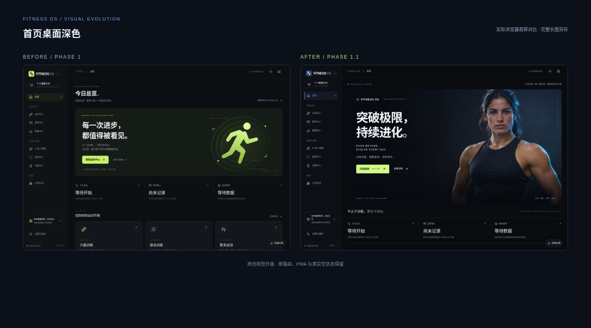
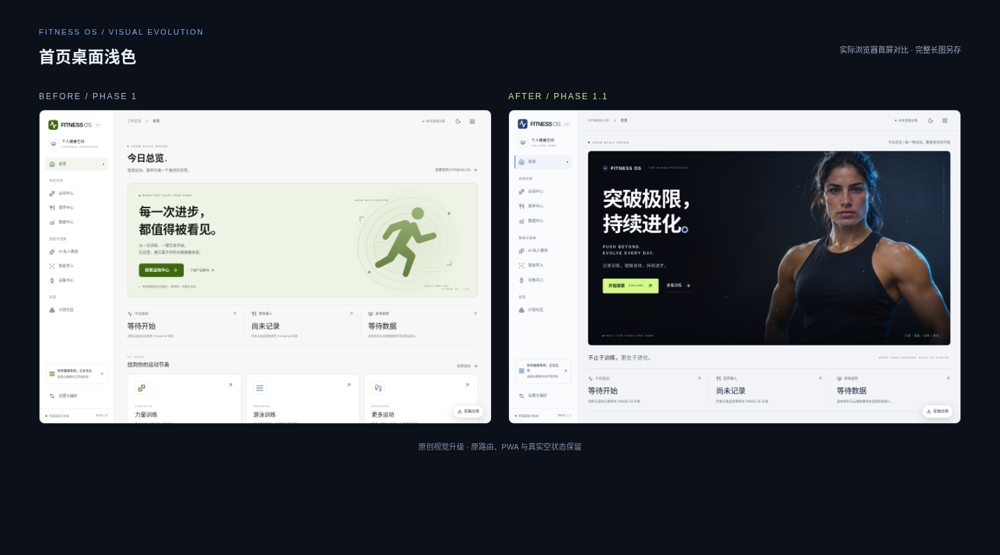
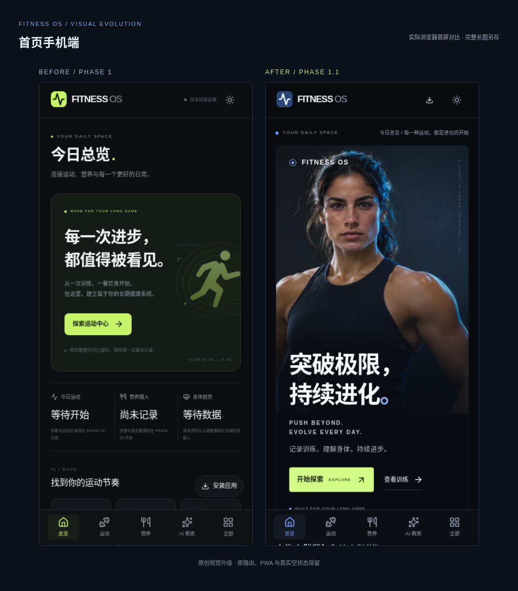
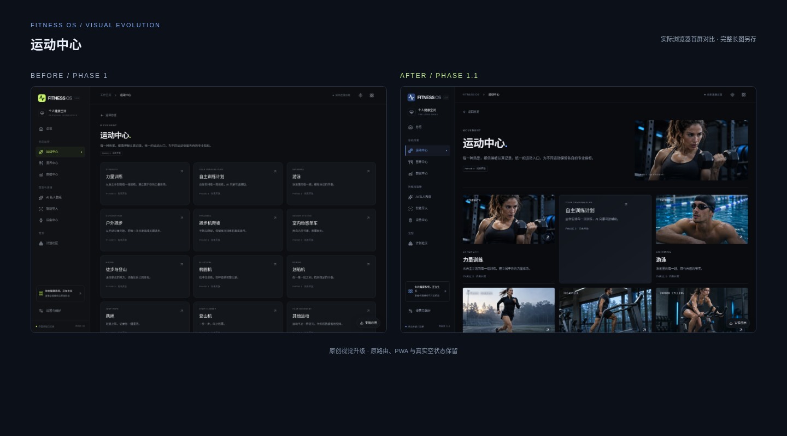
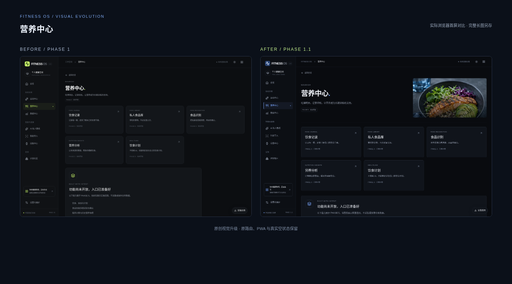
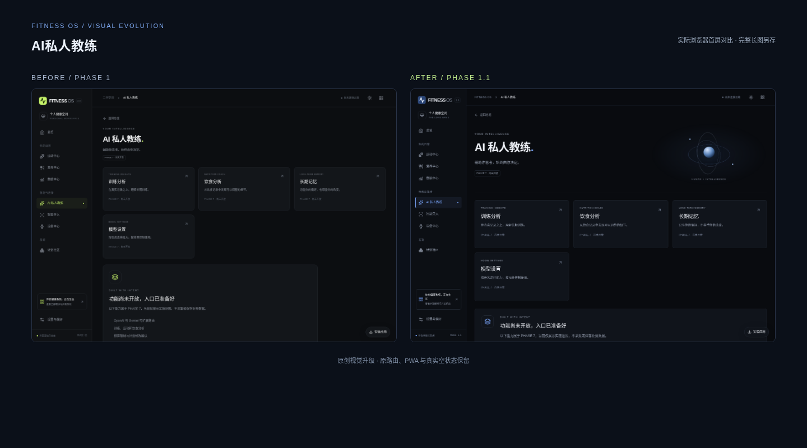
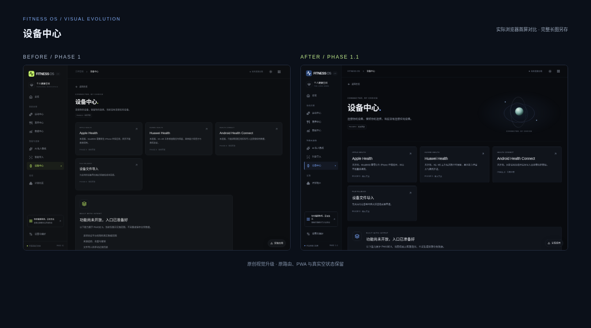

# FITNESS OS PHASE 1.1 — 七组真实截图对比

以下图片来自实际浏览器运行。左侧为PHASE 1，右侧为PHASE 1.1。对比图取相同首屏范围，完整长图通过下方链接查看。手机为390px浏览器视口，尚非真机验证。

## 首页桌面深色

[升级前完整图](before/01-dashboard-desktop-dark.png) · [升级后完整图](after/01-dashboard-desktop-dark.png)

## 首页桌面浅色

[升级前完整图](before/02-dashboard-desktop-light.png) · [升级后完整图](after/02-dashboard-desktop-light.png)

## 首页手机端

[升级前完整图](before/03-dashboard-mobile.png) · [升级后完整图](after/03-dashboard-mobile.png)

## 运动中心

[升级前完整图](before/04-sports-center.png) · [升级后完整图](after/04-sports-center.png)

## 营养中心

[升级前完整图](before/05-nutrition-center.png) · [升级后完整图](after/05-nutrition-center.png)

## AI私人教练

[升级前完整图](before/06-ai-coach.png) · [升级后完整图](after/06-ai-coach.png)

## 设备中心

[升级前完整图](before/07-device-center.png) · [升级后完整图](after/07-device-center.png)
