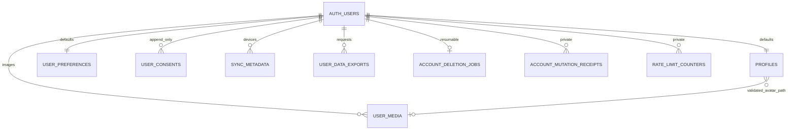

# PHASE 2 数据库与权限实施规格

本文件描述迁移 `supabase/migrations/20261103000100_account_foundation.sql` 的实际实现。原始 [DATABASE.md](DATABASE.md) 保持不变。PHASE 2 只创建正在使用的账户、偏好、同步、同意、私人图片、导出和删除实体；运动、营养、智能导入、AI 和手表实体仍保留在产品需求中，未提前创建空业务表。

## 实体关系



所有账户实体外键都指向 `auth.users(id) ON DELETE CASCADE`。图片二进制存储在私人 Storage 桶中，不能依靠 SQL 外键删除文件；删除流程必须先清理 Storage，再删除 Auth 用户。`avatar_path` 为经 RPC 验证的路径引用，媒体状态离开 `ready` 或媒体元数据删除时，数据库触发器原子清空相应头像并增加 profile 版本。

| 实体 | 主键/重要字段 | 约束 |
| --- | --- | --- |
| `profiles` | `id`、`username`、`display_name`、`avatar_path`、`version`、`created_at`、`updated_at`、`deletion_requested_at` | username 可空，`^[a-zA-Z0-9_]{3,24}$`，大小写不敏感唯一；display_name 最多64字符；avatar_path 最多300字符；版本从1递增 |
| `user_preferences` | `user_id`、`theme`、`language`、`unit_system`、`timezone`、`notification_preferences`、版本和时间戳 | dark/light；zh-CN/en；metric/imperial；时区经 `pg_timezone_names` 验证；通知严格为 `{email:boolean,push:boolean}` |
| `user_consents` | `id`、`user_id`、`scope`、`granted`、`policy_version`、`created_at` | scope 为 privacy_policy/terms/health_data/analytics/notifications；追加新决定，不覆盖历史；时间由服务器生成 |
| `sync_metadata` | `(user_id,device_id)`、`last_seen_at`、`last_synced_at` | device_id 为UUID，不保存设备指纹、令牌或健康数据；成功应用同步更新时间 |
| `user_media` | `id`、`user_id`、`object_path`、`mime_type`、`size_bytes`、`status`、时间戳 | 路径全局唯一且以用户UUID目录开头；png/jpeg/webp；1—5,242,880字节；pending/ready/deleting/failed；创建后路径、MIME、大小和身份不可修改 |
| `user_data_exports` | `id`、`user_id`、`format`、`status`、`object_path`、`error_code`、时间戳 | json/csv；pending/processing/completed/failed；可空文件引用必须属于本人；错误仅保存受限错误码 |
| `account_deletion_jobs` | `id`、唯一 `user_id`、`status`、`attempts`、`last_error`、时间戳 | requested/deleting_storage/deleting_auth/completed/failed；可重试；错误仅保存受限错误码；Auth删除成功后此记录也级联删除 |
| `app_private.account_mutation_receipts` | `(user_id,mutation_id)`、`request_payload`、`result`、`created_at` | RPC专用幂等收据；保留原始响应，包括冲突快照；不向API角色授予schema或表权限 |
| `app_private.rate_limit_counters` | `(user_id,action,window_start)`、`count` | RPC专用固定窗口计数；调用者无法自行指定额度；不向API角色授予schema或表权限 |

默认偏好为 dark、zh-CN、metric、UTC、邮件和推送关闭。时间戳均为 `timestamptz`，客户端负责按用户时区显示。版本使用 PostgreSQL bigint，客户端应只接受安全整数范围。偏好和个人资料的版本相互独立。

## RLS 与授权

全部九张应用表启用 RLS。每个账户RPC和所有本人行/Storage策略还验证JWT的session_id在auth.sessions中存在、归属本人且未超过not_after；退出登录删除Auth会话后，即使原access JWT尚未到期，也不能继续读写私人数据。缺少有效session_id的自签普通用户JWT同样被拒绝。`anon` 对应用表没有权限，也不能执行账户RPC。`app_private` 不在暴露的API schema中，并撤销匿名/登录角色的schema、表和函数权限。

| 资源 | 登录用户授权 | 所有权与写入条件 |
| --- | --- | --- |
| profiles、user_preferences | SELECT；通过 `apply_account_mutation` 写入 | 仅 `auth.uid()` 对应行；直接 INSERT/UPDATE/DELETE 均禁止 |
| user_consents | SELECT；仅 user_id/scope/granted/policy_version 列可INSERT | 本人且账户仍活跃；不能覆盖ID或创建时间；不能UPDATE/DELETE |
| sync_metadata | SELECT/INSERT/UPDATE/DELETE | 本人；INSERT/UPDATE要求账户活跃 |
| user_media、user_data_exports | SELECT/INSERT/UPDATE/DELETE | 本人；INSERT/UPDATE要求账户活跃；身份和创建时间不可改 |
| account_deletion_jobs | SELECT/UPDATE | 本人；创建只能经过删除RPC；状态用于恢复流程，删除操作始终由服务端重新校验当前用户 |
| 私有收据、计数表 | 无直接授权 | 仅固定搜索路径的 SECURITY DEFINER 函数访问 |
| storage.objects 的 private-media 桶 | SELECT/INSERT/UPDATE/DELETE | 第一层目录等于本人UUID；INSERT/UPDATE额外要求账户活跃 |

SELECT和清理DELETE保留至删除流程结束，方便导出、查看删除进度和重试文件清理。删除标记一旦存在，任何账户修改、图片/导出新增和 Storage 新增/改名立即被拒绝。Auth删除后，即使旧JWT尚未到期，活跃profile不存在也无法重新上传。

受控服务端可使用 `service_role` 执行 Auth 管理和应用表维护。该密钥绕过 RLS，不能发送到浏览器、日志、`NEXT_PUBLIC_*` 或Git。它没有被额外授予 `app_private` 的直接表权限。常规账户数据操作仍使用用户JWT，以便真实执行 RLS。

所有 SECURITY DEFINER 函数设置 `search_path = ''`，访问表、Auth和数据库函数时明确指定schema；没有接收调用者 `user_id` 的跨用户账户RPC。默认 PostgREST 暴露列表必须保持不包含 `app_private`。

## 同步RPC合同

```text
apply_account_mutation(
  p_mutation_id uuid,
  p_device_id uuid,
  p_entity text,          -- profile | preferences
  p_base_version bigint,
  p_patch jsonb
) -> {
  status: applied | conflict,
  entity: profile | preferences,
  record: 完整服务器记录,
  version: 当前服务器版本,
  mutation_id: 本次UUID
}
```

1. 用户必须已登录；实体、UUID、基础版本和补丁对象必须有效，补丁不为空且最多8KB。
2. 按 `(auth.uid(),mutation_id)` 插入并锁定幂等收据。JSON对象键顺序不影响比较；设备UUID、实体、基础版本和补丁都属于请求身份。相同请求重复返回原始完整响应；同ID不同请求报错。冲突响应也会缓存，解决冲突后须生成新的mutation_id。
3. 锁定本人profile，检查删除标记；再锁目标偏好行。删除请求使用同一profile锁，避免偏好写入与删除并发穿透。
4. profile补丁只允许 username/display_name/avatar_path；preferences只允许 theme/language/unit_system/timezone/notification_preferences。额外字段、无效类型、无效时区、其他用户头像和未就绪头像均拒绝。
5. 基础版本相同则更新并由服务器增加版本、更新时间；不相同则返回当前记录和 `conflict`，不覆盖内容。
6. 保存原始响应及设备同步信息。重放不再次写入、不再次计费限流、不改版本。

username唯一性冲突为SQLSTATE `23505`。其他输入错误使用 `22023`，关键message包括 `invalid_mutation`、`unknown_mutation_field`、`mutation_id_reused_with_different_payload`、`invalid_username`、`invalid_display_name`、`invalid_avatar_path`、`invalid_timezone`、`invalid_notification_preferences`。未登录、用户不存在或正在删除使用 `42501` 和 `authentication_required` / `account_not_found` / `account_deletion_in_progress` / `session_revoked_or_expired`。客户端应以code和受控message映射用户提示，不显示数据库细节。

## 限流与删除RPC

`consume_account_rate_limit(p_action text)` 返回 `{allowed:boolean,retry_after:number}`。固定窗口额度为 mutation 120次/分钟、media 30次/分钟、consent 30次/分钟、export 3次/小时、delete 3次/小时。窗口边界允许相邻窗口的突发请求；这不是跨窗口的平滑节流。`retry_after` 为剩余秒数，允许时为0。账户各自计数。无效action报 `22023 invalid_rate_limit_action`。长期运行应由受控维护任务清理过期计数行；不得缩短仍需保证离线重放的幂等收据保留期。

`apply_account_mutation` 内部消耗mutation额度，`request_account_deletion()` 首次调用内部消耗delete额度，API不应重复消耗。超额报 `P0001 rate_limit_exceeded`，DETAIL为上述限流JSON。media/consent/export路由在执行相应动作前调用限流RPC。

`request_account_deletion()` 原子锁定本人profile，设置 `deletion_requested_at`、增加profile版本，并创建删除任务，返回任务完整JSON。重复调用返回同一任务，失败后继续已有任务。服务端重新认证用户后，使用本人JWT删除全部私人文件并更新进度，再使用受控 Auth Admin 删除用户；最后通过外键级联清理数据库记录。删除失败保留标记和任务，禁止新增写入，允许重试。成功后无需保留包含用户身份的永久删除记录。

## Storage 与迁移安全

`private-media` 为私人桶，上限5MiB，允许 `image/png`、`image/jpeg`、`image/webp`。Storage服务执行桶级大小和Content-Type约束，服务端还应验证图片真实字节/MIME；SQL媒体元数据约束不能证明上传内容有效。路径使用 `<auth.uid()>/<随机名称>.<扩展名>`，拒绝双斜杠和 `..`。本阶段应用通过需要登录的受控下载接口读取文件，不持久化或签发签名URL。未来如使用签名URL，应限制有效期；退出无法提前撤销已签发的URL。SQL测试直接插入 `storage.objects` 仅检查RLS，不等同于真实文件上传测试。

已签发的Storage签名URL在自身有效期内仍是持有者可用的凭据，退出登录不会提前撤销该URL；建议最长60秒，禁止永久URL或缓存。会话实时检查保护需要JWT的直接REST/RPC/Storage请求。如果产品要求签名URL也立即失效，应改用每次校验会话的服务端图片代理。

迁移不会删除、覆盖或接管未知表。若上述公共表或 `app_private` 已存在，立即报冲突并要求先比对现有结构。若Storage已有策略，也会停止：多个PostgreSQL permissive策略以OR组合，直接叠加可能放宽私人桶权限，必须先单独审核。已有同名桶配置不一致同样报错。现有Auth用户会获得默认账户行，Auth本身不会被改写。

先在一次性本地Supabase运行迁移和测试，再审阅托管项目schema差异，最后由已授权的部署流程应用；不要对未知托管项目执行 `db reset`。此文档和迁移文件本身不代表已应用到用户的云项目。

## 验证入口

- `tests/database/account_foundation.sql`：真实PostgreSQL事务测试，含匿名/A/B隔离、直接写入拒绝、CAS、原始响应重放、UUID冲突、输入校验、头像清理、限流、删除标记、旧JWT写入阻断和级联清理，结束时ROLLBACK。
- `tests/integration/database.mjs`：真实Supabase HTTP/Auth/Storage集成验证，需本地URL、anon和service-role测试凭证；测试仅应指向隔离的本地实例，结束时清理测试用户和文件。
- SQL运行命令：`psql "$LOCAL_DATABASE_URL" -X -v ON_ERROR_STOP=1 -f tests/database/account_foundation.sql`。HTTP测试运行命令见脚本顶部。

是否实际通过、执行环境和限制以本次实施报告中的测试证据为准。没有云项目密钥和运行结果时，不宣称生产环境或云端RLS已验证。

### 本次本地真实验证结果（2026-11-03 UTC）

| 项目 | 实际结果 |
| --- | --- |
| 环境 | 隔离的本地Supabase；官方Docker数据库、Auth、PostgREST、Storage、网关和邮件收件箱，六项服务已运行 |
| 迁移版本 | `20261103000100` / `account_foundation` |
| 源SQL SHA256 | `e3ee70b56d33b0ab3d4e73e95525a5d1c16fa94624901006a92387c9f405f436` |
| 已部署内容比对 | 从本地 `supabase_migrations.schema_migrations.statements` 读取85条语句，与源SQL逐条精确匹配，仅忽略语句间空白和分隔分号；没有未部署的尾部语句 |
| SQL事务测试 | [account_foundation.sql](../tests/database/account_foundation.sql) 真实执行成功，79项断言（42次check_true、37次check_throws），打印PASS后ROLLBACK，退出码0 |
| HTTP/Auth/Storage测试 | [database.mjs](../tests/integration/database.mjs) 真实执行成功，报告113项命名断言，退出码0；含全部七张公共表匿名SELECT/INSERT/UPDATE/DELETE拒绝、并发CAS、原始幂等重放、JWT过期、缺少/撤销会话、撤销refresh token、真实文件大小/MIME、跨用户访问与删除级联 |
| 测试清理 | 实际数据库查询确认符合测试邮箱模式的临时账户剩余0，私人桶无孤立对象（0）；SQL测试整体回滚 |
| 托管云项目 | **待配置和验证**；上述结果不证明用户云项目已部署或可连接，没有把本地成功记作云端成功 |

本地Storage 1.88对直接SQL删除元数据有官方保护，返回 `42501`，应使用Storage API删除文件。SQL测试验证该保护；HTTP测试真实验证本人文件删除及跨用户删除失败。测试运行不需要关闭或绕过官方删除保护。运行日志保存在本次执行环境的 `/tmp/fitness-phase2-sql-results.log`、`/tmp/fitness-phase2-sdk-results.log`，不包含密钥或令牌。
