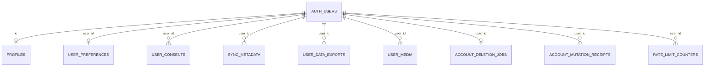

# PHASE 2 正式托管迁移计划

版本：2026-11-04。目标 Ref：`lrehapbujedrwpxzhqrt`。状态：**已提交审阅，尚未获准执行；补充只读检查、备份保存和执行通道仍为门槛**。

这是一份待批准计划。本轮已完成源码审查、哈希比对和用户数据库基线登记；**没有执行以下迁移命令或任何托管写入**。批准本计划前不会创建 schema、表、用户或桶。

## 1. 唯一迁移文件与授权范围

```text
文件：supabase/migrations/20261103000100_account_foundation.sql
版本：20261103000100
名称：account_foundation
SHA256：e3ee70b56d33b0ab3d4e73e95525a5d1c16fa94624901006a92387c9f405f436
本轮重算：一致
```

详细对象、权限与风险见 [HOSTED_MIGRATION_PREFLIGHT](HOSTED_MIGRATION_PREFLIGHT.md)。迁移本身不改写、不拆分、不补入演示数据；若 SQL 需要改变，重新计算哈希、出差异并重新等待批准。

计划申请的后续写入范围仅为：应用这一份账户基础迁移，并由官方工具初始化必要的迁移历史、登记这个版本。**不包括** seed、角色定义文件、Vault secrets 同步、Auth 配置 push、用户创建、邮件、真实用户修改/删除、数据库 reset、其他版本迁移或 PHASE 2.1 开发。批准迁移也不自动批准真实用户功能测试和清理操作。

## 2. 已知基线与执行门槛

已知状态来自用户在目标 SQL Editor 的成功只读检查：PostgreSQL 17.11 / postgres；目标范围内无业务表、策略、自定义触发器、函数、索引、约束；Auth 用户 0；桶 []；private-media 对象 0；迁移历史表不存在。详见 [基线登记](../delivery/phase2-hosted/MIGRATION_BASELINE_USER_REPORTED.json)。尚未收到原始 JSON 和数据库观察时间，不能将摘要当完整备份。

| 门槛 | 当前状态 | 执行前完成标准 |
|---|---|---|
| G1 项目身份/原始基线 | 用户已确认 Ref 与返回结果 | Dashboard 选中同一项目；保留带 observed_at 的原始结果，并在写前确认无漂移 |
| G2 源文件/版本 | 哈希一致、只有 1 个本地迁移 | 再算 hash；远端没有此版本或未知历史，不允许额外待执行文件 |
| G3 补充目录 | 待核实 | app_private namespace 不存在；目标同名关系/类型/函数无冲突；Storage 对象 RLS 开启；依赖列/函数/角色/owner/ACL 合适 |
| G4 安全/共享影响 | 源码已审查，托管元数据仍需核实 | app_private 不暴露；默认 ACL 不授予额外非预期角色；接受项目级 Auth 触发器及第 7 节列出的权限边界 |
| G5 备份与恢复依据 | 没有创建备份/恢复点 | 将原始/补查快照和相关 schema/ACL 定义导出安全保存，记录 hash、时间、范围、实际恢复方法及未演练限制 |
| G6 执行工具/权限 | 当前 PATH 无 supabase CLI；未核实授权 DDL 通道 | 获批后准备并核实官方 CLI 3.0.0、目标连接和 TLS；凭据只入安全配置，不写聊天/仓库/命令行明文 |
| G7 明确批准 | **未取得** | 用户批准这份具体计划；G1–G6 任何失败仍停止，不以批准绕过保护 |

Supabase Secret 已有 API 只读端点 200 的历史实测；它是应用管理员 API Key，**不能当数据库密码、CLI Access Token 或 DDL 授权**。本轮没有因此新增重复密钥或修改环境变量。若没有安全的数据库执行通道，保持阻塞，明确提供安全配置位置；不猜密码或在聊天里索取。

G3 可使用已准备的 [补充只读 SQL](../supabase/reviews/hosted_migration_preflight_readonly.sql)；本轮未执行。它不写数据库，也不调用应用 RPC。实际 Exposed schemas 在托管 API 设置核实，本地 config.toml 只是本地配置。原 SQL/本补查都不能靠 current_database=postgres 单独证明项目身份。

写入前应约定无注册/文件上传的短窗口；不自动修改 Auth 开关。若用户数、桶、策略或对象已变化，或无法确认并发写入影响，先重新审查新基线。当前 0 用户意味着预计 0 行回填，不能保证任意未来时间仍为 0。

## 3. 备份与恢复准备：不声称已完成

1. 保存用户 SQL Editor 的原始 hosted_schema_snapshot、补查 JSON/Notice、Dashboard 项目身份、数据库版本、观察时间和文件 hash。公开报告只保存必要摘要；私人完整资料放受控位置。
2. 在首次写入前取得相关 schema-only/定义与 ACL 导出：public 基线、app_private 与 supabase_migrations 是否存在、默认权限、auth.users 自定义触发器、Storage 桶配置/策略/RLS，以及迁移历史。记录导出工具/版本、时间、内容范围、校验和和可读性检查。只导出 public 不能覆盖此次全部关联范围。
3. 检查目标套餐是否实际提供可用备份/恢复功能、保留期和权限。**平台备份状态未知，没有现成恢复点证据，不开启付费备份或购买 PITR**。逻辑导出可用于对照和经审查的恢复，但未经演练不能宣称完整自动恢复能力。
4. 当前业务表/用户/桶均无，没有已知业务行或文件需要搬迁；若写前不再为空，暂停并扩大备份范围。数据库备份不包含 Storage 二进制文件；任何实际文件须另行备份并验证映射。
5. Auth 密码/身份信息、Secret 或真实健康数据不得进入 Git。全库/平台备份只能通过受控途径保存。恢复演练如需创建额外环境或对象，应另行批准，本轮不执行。

## 4. 获批后的执行工具与事务边界

**首选：官方 Supabase CLI 3.0.0，显式指定目标 remote。** 已只读审查对应版本官方源码；当前环境没有安装好的 CLI 命令，故执行前还须核实实际二进制版本和 `db push --help`。不自动换成其他版本、Management API 任意 SQL 或未跟踪的 SQL Editor 粘贴方式。

CLI 3 默认 db push 目标是本地，不能省略 remote。该版本还可能默认同步 config.toml 的 Vault 值，因此必须明确 `--skip-vault`；不带 `--include-seed`、`--include-roles`、`--include-all`，确认 db.seed.enabled=false，没有其他迁移/配置覆盖。不要运行 config push/reset/repair 或初始化整套远端项目。

以下为**批准后、所有门槛通过才可执行的计划命令，本轮未执行**。从 `fitness-os-2.0/` 项目根目录运行，凭据经私密环境/交互安全注入，命令不包含密码或 Secret：

```bash
supabase --version
sha256sum supabase/migrations/20261103000100_account_foundation.sql

# 审查实际目标及唯一 pending 文件，不能仅看到 dry-run 字样就跳过核查。
supabase db push --remote lrehapbujedrwpxzhqrt --skip-vault --dry-run

# 仅当目标、dry-run 内容、备份与批准范围完全匹配后执行一次。
supabase db push --remote lrehapbujedrwpxzhqrt --skip-vault
```

dry-run 预期只列 `20261103000100_account_foundation.sql`；不列 seed、roles、Vault 更新或其他版本。若工具请求修改网络封禁/项目设置等额外权限，或远端历史有新状态，停止审查，不能将其隐含在迁移许可内。原生 PostgreSQL TCP 连通尚未验证；HTTPS Auth 200 不能替代。

### 事务及迁移历史的明确范围

- 账户 SQL 没有顶层事务控制，也没有非事务并发建索引等语句。已审查 CLI 3 对这种文件使用同一批事务执行全部语句，并把版本 INSERT 放入同批；文件中途失败时不应提交部分应用对象或 applied 记录。
- **CLI 会先在另一个事务初始化迁移历史**：`supabase_migrations` schema（若不存在）、`schema_migrations(version text PRIMARY KEY, statements text[], name text)`，之后登记 `20261103000100 / account_foundation` 及语句。此为执行工具附加的元数据写入，不在账户 SQL 的 9 表之内。
- 目前历史表不存在；若业务事务失败，前置历史表可能已经留下但无版本行。必须只读核实，不自动删除它，也不报告“整个数据库完全恢复原样”。不用 seed 时不计划创建 seed_files。
- CLI 历史不是 SHA256 证明；继续记录外部源文件 hash，并核对真实对象/定义，不能只看到一行 version 就验收通过。
- 不分段执行 SQL，不忽略错误，不在失败后继续剩余语句。只跑一次；已完成版本正常应跳过，禁止直接重放非幂等 CREATE。

如果 CLI 通道确实不可用，**不自动改用 SQL Editor 执行迁移**。可另交付一份使用单事务、错误即回滚、且明确官方迁移历史登记方法的替代计划，供用户批准；单纯粘贴 SQL 不会自动生成迁移历史，不能事后假称 CLI 已跟踪。

## 5. 执行步骤及各步新增对象

| 顺序 | 动作 | 预期新增/影响 | 停止条件 |
|---|---|---|---|
| 0 | 补查、备份保存、批准及写前核对 | 无业务写入；记录真实观察结果 | 门槛不全、目标不符或基线变化 |
| 1 | CLI 明确目标、dry-run 核对 | 只列出计划，无应用迁移 | 出现额外文件/seed/roles/Vault 或新历史 |
| 2 | CLI 初始化迁移历史 | 必要时增加 history schema/table、PK 索引；此为独立事务 | 初始化错误或发现已有未知结构 |
| 3 | SQL 开始冲突保护 | 不覆盖既有对象；遇同名关系/app_private 即报错 | 任意冲突，不删对象绕过 |
| 4 | 创建账户 schema/表与约束 | app_private、9 表、44 表约束、15 应用索引 | 权限/依赖/对象错误 |
| 5 | 开启 RLS、收回默认 grants、赋权 | 9 表 RLS；18 public 策略；会话辅助函数 | ACL/会话依赖不符合审核 |
| 6 | 安装触发器及回填 | 3 private 函数、5 自定义触发器；现有用户各补默认 profile/preferences | 意外现有用户/触发器或注册冲突 |
| 7 | 安装账户 RPC | 限流、版本 CAS/幂等、删除申请 | RPC 创建/权限错误 |
| 8 | Storage 检查与配置 | private-media 私有 5MiB 3种 MIME；4 storage.objects 策略 | 任意既有 Storage 策略或不兼容桶 |
| 9 | 服务角色授权及历史记录 | 7 public 表 service_role grants；记录此版本；提交文件事务 | SQL 或历史 INSERT 失败 |
| 10 | 只读结构/权限/数据计数验证 | 输出真实新快照，不创建测试数据 | 数量、定义、ACL 或桶设置与计划不符 |
| 11 | 报告本次执行实际结果 | 更新状态、错误/时间/工具/版本/hash | 未通过不得签署托管最终验收 |

上述第 3–9 步为同一个文件事务；表中的停止条件意味着事务失败终止，不是人工提交前半段。创建过程中内部函数顺序以源 SQL 为准，不将表格重新拼接为另一份执行脚本。

## 6. 迁移后预期数据库结构



每条线均有 auth.users(id) FK 和 ON DELETE CASCADE。profiles/preferences 由新 Auth 用户触发器生成；o| 仅表示数据库 FK/唯一约束允许 0 或 1 行，不声称反向外键强制每个用户已有资料。

public：profiles、user_preferences、user_consents、sync_metadata、user_data_exports、user_media、account_deletion_jobs。app_private：account_mutation_receipts、rate_limit_counters，客户端无直接访问策略/权限。另有工具维护的 supabase_migrations.schema_migrations。

应用对象期望：9 表、9 PK、9 FK、2 UNIQUE、24 CHECK、15 索引、8 函数、5 自定义触发器、22 策略、1 私有桶。数量必须同时核对 schema/表/名称/定义/角色/owner/search_path，不能仅数对象。迁移历史表的 PK/索引和 FK 自动 RI 触发器不计入这些应用数量。

保持 0 用户、0 文件时：9 表预期均为空，Storage 只有桶配置新增，没有健康记录、图片、导出文件、训练数据或默认测试账号。迁移不会完成运动/营养/AI/手表后续阶段，也不会部署网站。

## 7. RLS 与 Storage 验证方法

### 7.1 获批迁移后先做只读结构验证

1. 在同一已确认项目重新运行原只读审查和补充脚本，保存新 observed_at 与结果。补充脚本的“colliding”字段在迁移后应显示**本次新增对象**，不能再用“必须为空”的迁移前门槛判断。
2. 核对 9 表 relrowsecurity=true、relforcerowsecurity=false；22 策略的 roles/命令/USING/WITH CHECK 对照审查报告。app_private 两表无客户端策略且不暴露 API。
3. 核对全部 FK 指向 Auth 用户且 ON DELETE CASCADE；检查唯一用户名表达式索引、媒体/删除任务 UNIQUE、24 个 CHECK、15 个索引的真实定义。
4. 核对 8 个函数 SECURITY DEFINER=true、search_path=''、owner 正确；public 函数仅允许计划中的角色执行；private 函数无 PUBLIC/anon/authenticated EXECUTE。检查表级和列级授权，尤其 consents 限定 INSERT 列。
5. 核对 auth.users 自定义触发器仅新增 fitness_os_account_defaults，调用 app_private.create_account_defaults；不改变原 Auth 表字段/管理函数。FK 的系统触发器单独识别，不混算为 5 个显式触发器。
6. 核对 private-media public=false、file_size_limit=5242880、allowed_mime_types 精确匹配 3 项；storage.objects 的 RLS 仍开启，只有审查过的 4 个策略，路径限制本人 UUID 目录。
7. 核对迁移历史恰有目标版本，名称/语句对应原文件；应用/用户/文件计数符合当时基线。若出现来源不明行，不删除以“满足预期”。
8. 可使用匿名、无用户会话的只读 API 请求验证私有表/桶不泄露；记录实际 HTTP/数据库响应。缺少授权应被拒绝或无可见记录；空库下返回空结果**不充分证明跨用户隔离**，不能写成 A/B 通过。

只读目录检查不会调用 apply_account_mutation、consume_account_rate_limit、request_account_deletion 等写入函数。也不直接 INSERT auth.sessions/伪造用户/JWT 来制造“真实认证成功”。

### 7.2 后续需独立授权的真实功能测试（现在未执行）

两个专用邮箱已经登记，不再索取或写入公开报告。以下测试会产生身份/数据/文件或邮件，**迁移许可本身不包含它们**：

| 类别 | 验证内容 | 通过依据 |
|---|---|---|
| Auth | 注册、邮件确认、登录/刷新/注销、密码找回 | 真实投递与回调证据；禁止自动确认冒充邮箱验证 |
| 跨用户 RLS | A/B 各建本人记录，逐表 SELECT/INSERT/UPDATE/DELETE 及猜测他人 ID | B 无法读取/篡改 A；核实数据库实际行未被改动 |
| 直接 API 权限 | profiles/preferences 直写拒绝、consents 限列/追加、private 表/函数不可访问 | 同时测试 REST/RPC，不能仅测 Next.js 页面 |
| 会话 | 注销后旧 JWT、过期/缺失 session_id、他人会话 | 业务 RLS/Storage 与 RPC 拒绝；管理员结果不作为用户证明 |
| 同步/RPC | 版本冲突、并发设备、幂等重试、不同 payload 重复 ID、字段白名单 | 无静默覆盖，冲突可恢复，幂等只产生一次修改 |
| Storage | 本人合法图片、B 访问/覆盖/删除、匿名访问、跨目录移动、5MiB 边界、错误 MIME/魔数 | 检查 Storage API 与业务入口各自边界，不把应用校验误记为所有入口校验 |
| 文件生命周期 | failed/pending/ready、删除头像、孤儿文件对账 | SQL 元数据和真实文件一致；不以 CASCADE 冒充文件已清理 |
| 导出/删除 | JSON/CSV/完整分页、删除密码复验/二次确认、Storage 失败重试 | 只使用获准的临时身份/fixture；正式用户绝不参与删除测试 |
| 客户端隐私 | PWA/浏览器缓存、日志与响应缓存、Secret 不入 bundle | 不缓存私人健康/身份数据；无密钥泄露 |

RLS 源码当前允许 authenticated 直接维护本人 media/export 元数据及 deletion job 状态，隔离成立也不代表这些状态可信为服务端审计；直接请求也可能绕过应用限流与图片内容检测。若需要服务端独占处理状态/入口，应在开放用户前提交权限收紧方案并复审，不能无声改变这份哈希迁移。

固定窗口限流和内部回执没有自动保留期清理；需后续容量/资源配额评估。未授权前不增加 cron、队列或收费服务。

### 7.3 网站与邮件前提

当前没有正式公网网站。Cloud 的 127.0.0.1 指向云端容器，用户浏览器的回环地址指向用户设备，不能作为正式用户邮箱验证入口。获准真实邮件测试前须确定实际可用 HTTPS origin、显式配置并核实 APP_URL 与 Supabase Site URL/Redirect URLs；不会自动切换。当前不修改这些设置，不发送测试邮件。

## 8. 失败、断线与回滚方案

| 情况 | 处理 | 禁止动作 |
|---|---|---|
| G1–G7 未通过或 dry-run 与计划不符 | 停止，保留只读结果并更新阻塞 | 不删除旧对象、不追加其他迁移、不扩大许可 |
| 文件事务内 SQL 失败 | 保存脱敏错误/SQLSTATE/步骤；确认回滚；只读核对对象/桶/Auth 触发器/历史 | 不继续执行剩余语句，不循环重跑 |
| 历史初始化已提交，业务事务失败 | 可能仅多出空 history schema/table；记录实际状态，后续按官方机制处理 | 不自动 DROP supabase_migrations，不虚构“全库未变” |
| 连接断开，COMMIT 状态未知 | 先只读核对版本和每个对象，确认全部/部分/未提交 | 不凭退出码猜测，不直接重放 SQL 或 repair applied |
| 业务已提交但只读验证失败 | 停止后续业务/测试，保存现场，提交前向修复或受控恢复方案 | ROLLBACK 不能撤销旧 COMMIT；禁止 reset/清库 |
| 提交后已有用户/数据/文件 | 扩大备份并评估数据保留/恢复，优先前向修复 | 不以迁移前空库为由删除新增用户/对象 |

### 如何恢复到迁移前状态

- 如果整个账户文件事务失败，事务回滚应撤销该文件的 schema/表/函数/策略/Auth 触发器/桶插入；随后用两份只读快照比较实际基线。工具独立提交的历史结构需单独记录，不能假设一起消失。
- 如果账户文件已经提交，现有计划**没有自动 down migration**。恢复必须基于预先保存的定义和实际数据，另出逐对象清单并等待明确删除/恢复许可。可能涉及先解除 Auth 用户新触发器和 Storage 策略的依赖，再处理应用函数/FK/表、桶和历史；这只是依赖审查方向，不是本轮授权或可直接执行的删除脚本。
- 只有确认没有迁移后用户/文件/业务行，且新增对象来源可证明时，才可讨论撤销这些特定新增对象。禁止删整个 auth/storage schema、原管理表、平台角色、现存共享策略或不明对象。
- 桶存在文件时用官方 Storage API 对象生命周期处理；仅删除 storage.objects/buckets 元数据不能恢复/清理二进制。迁移历史应与真实状态一致，不能用 repair 命令代替数据恢复。
- 平台全项目恢复可能覆盖 Auth 和其他管理对象，对共享系统影响大；必须确认实际可用恢复点、影响范围和另行授权。当前没有创建或验证这种恢复点。

Supabase 管理对象的预期变化仅为已申明的 auth.users 新触发器/FK 依赖、Storage 桶配置与 4 个策略。正常事务失败不应改 Auth 用户数据或平台表定义；若发现意外变化则保留证据，不能越权自动“修复”。

## 9. 执行后交付与停止点

实际获批执行后才填写：开始/结束时间、目标 Ref、工具版本、源 hash、历史版本、执行退出状态、脱敏错误、前后只读快照 hash、对象/ACL 差异、备份实际位置和范围（不公开私人路径/内容）、未测项目及恢复限制。相应更新 CLOUD_ENV_SETUP、HOSTED_SCHEMA_REVIEW、PHASE2_HOSTED_ACCEPTANCE_REPORT 与本计划状态。

通过结构只读检查可报告“账户结构已迁移、目录核对通过”；不能据此报告真实邮箱认证、A/B RLS、Storage 上传或完整托管验收成功。

**本轮停止点已经设定：提交本计划，等待用户明确批准，不执行迁移。** 执行前未解决的只读/备份/通道门槛仍需满足；若计划、哈希或目标范围变化，重新提交审阅。PHASE 2.1 BRAND STUDIO 保持强制后续阶段，不启动；不进入其他阶段、不发布网站、不购买服务。
