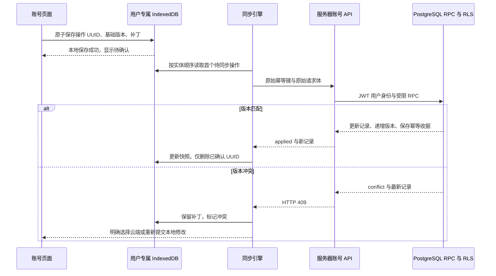

# PHASE 2 同步架构

本阶段同步的是账号资料和个人偏好。运动、营养、GPS、设备、AI 和长期记忆的业务写入属于后续阶段；没有用占位记录模拟这些业务同步。

## 数据与边界

- Supabase PostgreSQL 是服务器确认版本的来源。`profiles` 与 `user_preferences` 各自维护递增版本。
- 浏览器数据库 `fitness-os-private-<auth-user-id>` 保存真实服务器快照和待同步操作。IndexedDB 的单次读写事务同时更新队列，避免覆盖另一标签页刚写入的数据。
- 每个操作包含 UUID 幂等键、设备 UUID、实体、基础版本和字段补丁。不保存密码、服务端密钥或认证令牌。
- 公共 Service Worker 仅缓存公开静态品牌素材；账号页面、API、私人图片和 IndexedDB 内容不进入公共缓存。私人路径不会被 Service Worker 拦截；离线首次打开或刷新私人页面可能显示浏览器网络错误，联网后重新打开即可。公开页面离线刷新显示通用外壳。已打开且会话尚未过期的账户页面可以继续向队列写入。

## 写入流程

客户端对连续离线操作使用预测的连续版本。页面可以投影显示尚未确认的补丁，但明确说明这是本地视图，不能据此声称已经写入云端。

## 重试、幂等与冲突

网络中断、超时、HTTP 429 和服务器错误保留原操作。重试使用同一个幂等键和同一个请求体，采用约 1–60 秒指数退避及少量抖动。HTTP 429 优先使用有上限的 `Retry-After`。服务器已提交但客户端没有收到响应时，收据重放不会再次增加版本。

HTTP 401 暂停同步并要求重新验证会话。无效输入等永久错误显示失败原因，用户可备份待同步内容后明确丢弃该项；系统不会自动删除错误操作。队列达到 200 条后拒绝新增并说明原因，不淘汰已有内容。

冲突会阻止同一实体的后续写入，另一个实体仍能同步。用户可以：

1. 使用云端版本：只放弃已确认选择的那项本地补丁。
2. 保留本地修改：以最新版本创建一个新的操作 UUID，再次提交；若云端继续变化，仍会再次提示冲突。

在这个明确选择之后，从未传输的后续同实体操作可以按新版本顺序重新编号。已经传输过的操作不修改请求体或幂等键，避免破坏服务器收据语义。

## 多设备与多标签页

登录和读取到新的账号主题偏好时，应用会更新实际主题；公开导航栏的主题按钮仍可临时改变当前设备显示。保存账号主题会经过同步队列，其他设备读取到该偏好后也会更新显示。

同一账号在独立浏览器或手机登录，通过账号 API 访问同一组数据库记录。已打开的页面每 5 秒尝试刷新，并在重新聚焦、恢复网络时刷新；这是尽力而为的轮询周期，浏览器后台节流或网络延迟可能增加等待时间。本阶段不要求付费消息服务，也没有宣称已经实现所有业务数据的 Realtime 订阅。

同源标签页优先使用 Web Locks；不支持时使用 IndexedDB 中带 45 秒有效期、每 10 秒续期的租约。BroadcastChannel 通知其他页面重新读取本地状态。数据库端版本锁和幂等收据仍是最终正确性保障，不能依赖标签页锁代替。

## 会话与私人缓存

- 正常退出通过账号安全页面执行。存在未同步操作时，必须先让用户选择备份、取消退出或明确确认清除。
- 已登录账号不能在登录或注册页面直接切换身份；需要先经过上述退出流程。
- 明确且经过待同步确认的退出会关闭旧连接并删除旧账号 IndexedDB。非预期会话失效或账号变化会清除旧服务器快照及缓存的冲突记录，同时保留原账号专属的待同步补丁，避免无提示丢失。新账号使用独立数据库，界面按身份重新挂载，表单和文件列表不会延用前一个账号的数据。
- 会话过期时立即清空内存中的账号视图并移除可用服务器快照；只保留原账号专属的待同步补丁，供同一账号重新验证后恢复。登录其他账号不能在界面或 API 中读取这份队列；回到原账号才会重新尝试同步。共享设备使用者应在会话有效时主动退出；浏览器本地存储不是加密保险箱。
- SDK 的 SIGNED_OUT 事件不能自行区分人为退出和令牌刷新失败。正常退出和已确认删除使用不含令牌的短期意图标记；没有该标记的事件按会话失效处理，保留隔离队列。重复清理合并为同一 Promise，避免两个删除请求互相干扰。
- 如果其他页面占用本地数据库而导致清理失败，显示持续可见的清理提示和重试按钮，不报告完全清理成功。

## 测试与状态

`tests/unit/sync-model.test.ts` 验证版本预测、单项确认、冲突阻塞、显式重新提交、已传输请求不可变、退避和队列容量。`tests/e2e/phase2-sync.spec.ts` 使用真正的本地 Supabase、两个独立浏览器会话、真实 IndexedDB、断网和丢失响应测试跨设备同步及退出隔离。测试启用条件为 `PHASE2_AUTH_INTEGRATION=1`，同时限制集成测试账号的管理员调用只能指向 loopback 服务。

本文件描述实现与验证方法，不把本地服务测试替代成用户托管 Supabase 项目的云端验收。最终实际运行结果以 `TEST_REPORT.md` 和 `PHASE2_IMPLEMENTATION_REPORT.md` 为准。
